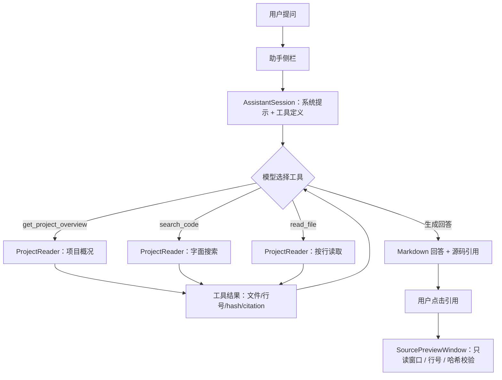
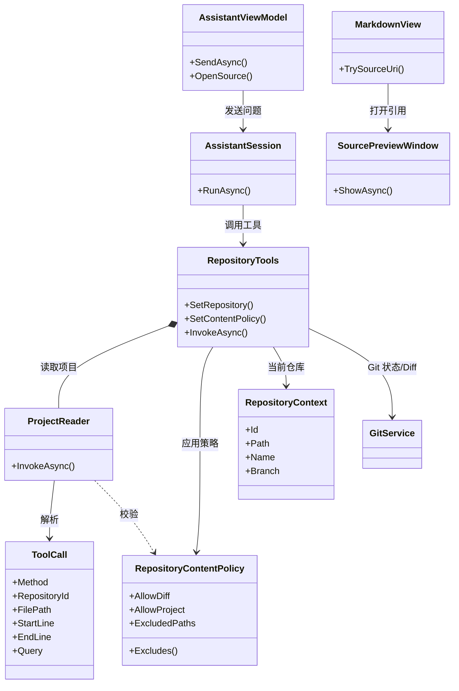

# GitManager 需求规格说明书

| 项目 | 内容 |
| --- | --- |
| 项目名称 | GitManager |
| 团队名称 | 解码小队 |
| 文档版本 | V1.2 |
| 日期 | 2026-11-08 |
| 状态 | 本次作业提交版 |
| 代码仓库 | [https://github.com/hhd233cored/GitManager](https://github.com/hhd233cored/GitManager) |
| 相关文档 | [助手与 MCP 说明](assistant.md)、[README](../README.md) |

## 1. 文档说明

### 1.1 编写目的

本文档定义 GitManager 的“解读项目”能力及其前后端需求、安全边界和验收标准，作为开发、联调、答辩和最终验收的依据。文档只描述当前版本的范围，不把未实现的能力写成已完成。

### 1.2 适用范围

适用于 GitManager 的 Windows 桌面客户端、内置 Git 助手、本机 stdio MCP 服务，以及项目概况、目录浏览、代码搜索、按行阅读和源码引用相关的前后端实现。

### 1.3 参考标准

- GB/T 8567-2006《计算机软件文档编制规范》
- GB/T 9385-2008《计算机软件需求规格说明规范》
- 项目仓库中的 [README](../README.md) 和 [助手与 MCP 说明](assistant.md)

### 1.4 术语

| 术语 | 含义 |
| --- | --- |
| 工作区 | 当前打开仓库的本地文件树，包含未提交修改 |
| 工具调用 | 模型通过结构化工具读取仓库状态、Diff 或项目源码的动作 |
| citation | 指向具体文件和行号的源码引用，格式为 `gitmanager-source://...` |
| 内容策略 | 控制是否允许读取 Diff、项目源码及排除路径的服务端规则 |
| MCP | Model Context Protocol，本项目中由独立 stdio 进程桥接到运行中的 GitManager |

## 2. 项目概述

### 2.1 项目标志


标志沿用 GitManager 应用图标：蓝色圆角方块上是一条白色 Git 分支，三个提交节点由一条主线和一条支线连接，表示版本、分支与合并。项目名为 GitManager，团队名为“解码小队”。

### 2.2 项目简介

GitManager 是一个 Windows 桌面 Git 客户端。界面左侧为 Changes，中间为 History，右侧为 Diff，助手侧栏可以收起。当前版本已经支持读取仓库状态、历史、提交详情和文件 Diff，生成提交说明草稿，解释提交或 Diff，分析同步差异，并把同步、变基、重置、撤销做成操作计划，等用户在界面确认后执行；同一套工具通过本机 stdio MCP 服务开放给外部客户端。

本次作业在现有 Git 客户端上增加“解读项目”能力：助手可以在当前工作区查看项目概况、按目录浏览文件、按字面搜索代码、按行读取源码，并把关键结论链接回具体文件和行号。

### 2.3 目标用户

| 用户 | 主要需求 |
| --- | --- |
| 课程项目开发者 | 快速理解仓库结构、解释提交和改动 |
| 刚接手仓库的新成员 | 找到入口、分层和关键实现，减少逐个文件翻找 |
| 代码评审者 | 核对结论对应的源码行，确认文件和内容没有变化 |

### 2.4 运行环境

| 项目 | 要求 |
| --- | --- |
| 操作系统 | Windows 10/11 |
| 运行时 | .NET 10 Desktop Runtime；开发需要 .NET 10 SDK |
| Git | Git for Windows，已加入 PATH |
| 模型服务 | 支持 Chat Completions 和工具调用的 OpenAI 兼容服务；云端或 Ollama、LM Studio 等本机服务均可 |
| 网络 | 使用云端模型时需要网络；本机模型可离线 |
| MCP | 可选；启用后由独立 stdio 进程桥接到运行中的 GitManager |

### 2.5 项目目标与范围

本阶段的目标是让“项目理解”成为 Git 客户端中一项可靠的能力，而不是只会聊天的附属窗口。

| 范围内 | 范围外 |
| --- | --- |
| 项目概况、目录浏览、代码搜索、按行阅读 | 自动修改代码、自动提交、自动执行测试或构建 |
| 内置助手 + 本机 MCP 两个入口 | 连接第三方 MCP 客户端、托管多用户服务 |
| 源码引用、读取与检索记录 | 语义检索、向量库、完整调用图、Roslyn/LSP |
| 内容策略、路径校验、大小与编码限制 | 读取任意历史版本、分析 Stash 预览 |
| 预算、截断、缓存、取消 | 跨会话持久记忆、云端同步对话 |

### 2.6 项目愿景

我们希望 GitManager 成为开发者打开仓库后首先使用的工具：Git 操作安全完成，项目本身也能用自然语言问清楚。新成员不用先翻几十个文件，评审时关键结论能点回源码，危险操作仍然由人确认。

## 3. 迭代记录

| 版本 | 日期 | 修改内容 | 状态 |
| --- | --- | --- | --- |
| V1.0 | 2026-11-06 | 项目概况与目录浏览：`get_project_overview`、`list_files`，先建立项目结构视图 | 已完成 |
| V1.1 | 2026-11-07 | 代码搜索与按行阅读：`search_code`、`read_file`，返回行号、片段和内容哈希 | 已完成 |
| V1.2 | 2026-11-08 | 源码引用与安全边界：citation/SHA256、内容策略、敏感路径与链接校验、MCP 复用；最终提交 `e9a24f9` | 已提交 |

## 4. 需求来源与用户场景

### 4.1 需求来源

当前 GitManager 的助手主要做两件事：解释 Git 状态，生成操作计划。查看现有 9 个 MCP 工具可以发现，它们都围绕仓库状态、历史、Diff 和计划，没有一个能读取项目源码。因此，助手能解释一次 Diff 改了什么，却无法说明改动落在哪条调用链上；能列出发生变更的文件，却不能从入口追踪到实现。

需求来自现有工具清单、代码、组内试用和身边同学的非正式交流。下面的三个卡点在组内试用和联调中都出现过，是本次功能设计的直接依据。

| 卡点 | 当前表现 | 用户想要 | 本次对应能力 |
| --- | --- | --- | --- |
| 解释提交缺少调用链 | 只读提交详情和关键 Diff，看不到被调用方 | 结合源码说明改动落在哪条链路 | 项目概况 + 代码搜索 + 按行阅读 |
| 新人接手靠人带 | 不能浏览、搜索、读源码，只能逐个文件打开 | 打开仓库就能问入口和分层 | 目录浏览 + 代码搜索 + 源码阅读 |
| 架构说明不可核对 | 通用模型能写架构描述，但无法证明对应真实代码 | 关键结论能点回文件和行号 | 源码引用 + 内容哈希 + 引用失效 |

联调中遇到过：同一个提交修改了 `RepositoryTools` 和 `AssistantSession`，现有助手只能分别复述两边 Diff，说不清它们在一条调用链上的关系。

### 4.2 用户角色

| 角色 | 主要目标 | 使用方式 |
| --- | --- | --- |
| 开发者 | 理解仓库结构、解释提交和改动 | 内置助手侧栏，自然语言提问 |
| 新成员 | 找到入口、分层和关键实现 | 目录浏览、代码搜索、按行阅读 |
| 评审者 | 核对结论对应的源码行 | 点击 citation，在只读窗口查看行号和哈希 |
| 外部 MCP 客户端 | 在外部工具中读取当前仓库 | 通过本机 stdio MCP 调用同一套工具 |

### 4.3 用户故事

- US1：作为刚接手仓库的新成员，我问“入口在哪、分几层”，助手浏览目录并读取关键文件，回答里的关键结论可以点回源码。
- US2：作为提交者，我问“这次提交为什么同时修改 `RepositoryTools` 和 `AssistantSession`”，助手结合 Diff 和源码说明调用链。
- US3：作为评审者，我点击回答里的 citation，在只读窗口核对行号和 SHA256；文件变化时得到提示，仓库切换后旧引用失效。

## 5. 功能需求

### 5.1 功能清单与优先级

| 编号 | 功能 | 优先级 | 实现方式 |
| --- | --- | --- | --- |
| F-01 | 项目概况：文件数、顶层目录、扩展名统计、项目清单、README 片段 | 高 | `get_project_overview` |
| F-02 | 目录浏览：按目录、深度 1–8、每页最多 200 项 | 高 | `list_files` |
| F-03 | 代码搜索：字面匹配、路径限定、大小写选项、每页最多 100 处 | 高 | `search_code` |
| F-04 | 按行阅读：1 起始行号、每次最多 200 行 / 16,000 字符、`nextLine` | 高 | `read_file` |
| F-05 | 源码引用与读取记录：citation、SHA256、工具轨迹 | 高 | `MarkdownView`、`SourcePreviewWindow` |
| F-06 | 内容策略：内容共享总开关、项目阅读开关、额外排除路径 | 高 | `RepositoryContentPolicy` |
| F-07 | 双入口：内置助手与本机 MCP 共用工具和策略 | 中 | `RepositoryTools`、`GitManager.Mcp` |
| F-08 | 预算与截断：工具调用次数、上下文字符、轮次、超时 | 高 | `AssistantSession` |
| F-09 | 缓存与失效：读取按 SHA256 复用，概况按身份/策略/文档哈希失效 | 中 | `ProjectReader` |
| F-10 | 前端设置与会话：模型连接、内容设置、仓库/分支切换清空 | 高 | `AssistantViewModel`、设置窗口 |
| F-11 | 安全边界：路径、敏感文件、链接、大小、编码校验 | 高 | `ProjectReader`、`RepositoryTools` |
| F-12 | 错误提示：无仓库、未配置模型、超时、预算用尽、扫描受限 | 中 | 助手侧栏、工具错误信息 |

### 5.2 功能思维导图

```text
GitManager · 解读项目
├── 入口：内置助手 / 外部 MCP
├── 项目理解工具：项目概况 / 目录浏览 / 代码搜索 / 按行阅读
├── 回答与引用：Markdown / 工具轨迹 / 源码引用窗口
├── 安全边界：只读 / 路径校验 / 敏感文件 / 内容开关
└── 资源与预算：分页 / 截断 / 扫描上限 / SHA256 缓存
```

### 5.3 项目工具契约

| 工具 | 关键输入 | 返回 | 上限与说明 |
| --- | --- | --- | --- |
| `get_project_overview` | 无 | 文件数、顶层目录、扩展名统计、项目清单、README 片段、citation/hash | 概况片段约 16,000 字符；只静态读取，不运行构建 |
| `list_files` | `filePath`、`depth` 1–8、`limit` ≤200、`skip` | 目录/文件、`total`、`nextSkip`、`inventoryTruncated` | 清单最多 50,000 个可读文件；Git 输出最多 4 Mi 字符 |
| `search_code` | `query` 1–300 字、`filePath`、`matchCase`、`limit` ≤100、`skip` | 文件、行号、片段、hash、citation、`scanLimited`、`nextSkip` | 单次最多 3,000 个文件 / 24 Mi 字符 / 25 秒；字面匹配，不是正则 |
| `read_file` | `filePath`、`startLine`、`endLine` | 行号、文本、hash、`totalLines`、`truncated`、`nextLine`、citation | 每次最多 200 行 / 16,000 字符；文件 ≤1 MB；UTF-8 或带 BOM 的 UTF-16；不读二进制 |

### 5.4 前端功能需求

| 编号 | 模块 | 需求 | 验收要点 |
| --- | --- | --- | --- |
| FE-01 | 助手侧栏 | 可收起；包含聊天、设置、草稿和操作预览 | 打开仓库后可从右上角“助手”进入 |
| FE-02 | 消息渲染 | 支持 Markdown 标题、强调、列表、代码、引用、表格、网页链接；HTML 以文字显示，图片显示替代文字 | 不自动访问外部资源；文本可选择复制 |
| FE-03 | 读取与检索记录 | 每次工具调用显示“查看项目概况 / 浏览项目文件 / 搜索代码 / 读取源码”，带路径或查询词 | 可展开/收起；顺序与实际调用一致 |
| FE-04 | 源码引用 | 回答中的 `[文件:行号](gitmanager-source://...)` 可点击；只接受 32 位十六进制仓库 ID | 不通过 shell 打开本地文件 |
| FE-05 | 源码预览窗口 | 只读；显示行号；定位到引用行；显示 SHA256；文件变化时提示“以下为当前工作区内容” | 仓库或分支切换后旧引用失效 |
| FE-06 | 设置 | API 基础地址、模型名、API Key、流式开关；内容共享总开关；项目阅读开关；额外排除路径 | 关闭后内置助手和 MCP 同时受限 |
| FE-07 | 会话 | 多轮对话只保留在当前应用会话；切换仓库/分支/设置时停止旧分析并清空 | 不把 A 仓库的上下文带到 B 仓库 |
| FE-08 | 错误提示 | 无仓库、未配置模型、模型不支持工具调用、超时、预算用尽、扫描受限、文件被排除 | 提示能指导下一步操作，避免只显示“失败” |

### 5.5 后端功能需求

#### 5.5.1 分层

| 层 | 项目 | 职责 |
| --- | --- | --- |
| 界面 | `GitManager.App` | 助手侧栏、Markdown 渲染、源码引用窗口、设置、计划审批 |
| 智能体 | `GitManager.Agent` | 系统提示、工具注册、工具循环、上下文预算、流式输出 |
| 共享服务 | `GitManager.Services` | `RepositoryTools`、`ProjectReader`、内容策略、共享队列、本机通信 |
| 核心 | `GitManager.Core` | `GitService`、历史、Diff、同步、操作与恢复点 |
| MCP | `GitManager.Mcp` | 独立 stdio 进程，桥接到运行中的 GitManager |

#### 5.5.2 智能体循环与预算

聊天任务最多 32 次数据工具调用、约 160,000 字符工具上下文、16 轮模型工具循环、5 分钟超时；提交草稿等专用任务为 16 次、100,000 字符、8 轮、3 分钟。

系统提示要求：理解项目时先用 `get_project_overview` 了解结构，再用 `list_files`、`search_code`、`read_file` 按需追踪；`search_code` 是字面搜索，不是语义引用查询；只引用已读取的 citation；不编造调用关系或测试结果；遇到 `scanLimited` 要缩小目录继续查；项目工具读取当前工作区，不能称为 HEAD 的内容。

提交草稿任务不能用项目工具扩大读取范围，只能读取本次勾选文件的 Diff。

#### 5.5.3 并发、缓存与失效

项目读取先在共享队列内捕获仓库身份和内容策略，然后到后台执行，最多 2 个并行读取；返回前再次校验仓库身份和策略，防止读到一半切换仓库。Git 写操作仍走串行队列；长时间读取不占用 UI 的 Git 操作队列。

文本缓存按 SHA256 复用，最多 32 个文件 / 4 Mi 字符；每次读取仍重新计算哈希，不能只依赖修改时间命中。项目概况缓存按“仓库/分支身份 + 文件清单 + 访问策略 + 文档哈希”生成键；切换上下文或策略即失效。持久缓存只写来源路径、分支和哈希记录，不保存源码、对话或模型摘要。

#### 5.5.4 安全边界

- 模型只有结构化工具，没有通用 Shell，也没有任意 Git 命令入口，不能提供可执行文件或命令参数。
- 只允许仓库内相对路径；绝对路径、`..`、`.git`、空路径段和带冒号的路径都会被拒绝。每一级目录检查是否为 reparse point（链接/junction）；Windows 上再用 `GetFinalPathNameByHandle` 校验打开文件的实际路径与仓库路径一致。
- 默认不读取 `.env`（`example`/`sample`/`template` 除外）、`id_rsa`、`id_ed25519`、`credentials`、`.npmrc`、`.netrc`、`.pem`/`.key`/`.pfx`/`.p12`；默认排除 `.git`、依赖和构建目录、链接目录/文件。
- 单文件最多 1 MB；不读取二进制；只接受 UTF-8 或带 BOM 的 UTF-16。
- `AllowDiff`、`AllowProject`、`ExcludedPaths` 由服务层执行；设置中的“允许共享仓库内容”和“启用项目概况、文件浏览、源码阅读与代码搜索”同时约束内置助手和 MCP；额外排除路径每行一个相对路径、目录或 `*`/`?` 通配模式。
- API Key 按服务地址存入 Windows 凭据管理器，不写入 `settings.json`/`assistant.json`；工具错误信息对 URL 中的用户名、密码和 token 脱敏。

#### 5.5.5 MCP 复用

MCP 是独立 stdio 进程，只桥接到运行中的 GitManager，不另起 Git 实例。外部客户端先调用 `get_active_repository` 获取不透明仓库 ID，后续调用携带该 ID。

四个项目工具与内置助手共用 `RepositoryTools` 和 `RepositoryContentPolicy`，MCP 不能绕过内容开关、排除路径或路径校验。`apply_operation_plan` 只把计划转为“等待界面审批”，不直接执行写操作；实际执行仍由用户在 GitManager 界面确认。

### 5.6 关键流程



用户提问后，`AssistantSession` 把系统提示和工具定义发给模型；模型按需调用项目工具，结果带 `citation` 和 `hash`；模型只根据已读取结果回答。用户点击引用后，`SourcePreviewWindow` 重新读取当前文件，校验仓库身份和内容哈希，再显示只读内容。文件变化时窗口提示“文件已变化”，仓库或分支切换后旧引用失效。

### 5.7 数据与接口

#### 5.7.1 核心对象

| 对象 | 字段 | 说明 |
| --- | --- | --- |
| `RepositoryContext` | `Id`、`Path`、`Name`、`Branch` | 不透明仓库 ID；切换仓库/分支后旧 ID 失效 |
| `ToolCall` | `Method`、`RepositoryId`、`FilePath`、`CommitId`、`Limit`、`Skip`、`Query`、`StartLine`、`EndLine`、`MatchCase`、`Depth` | 结构化工具调用参数 |
| `RepositoryContentPolicy` | `AllowDiff`、`AllowProject`、`ExcludedPaths` | 服务端内容策略 |
| `OperationPlan` | `Id`、`RepositoryId`、`Action`、`Preview`、`Fingerprint`、`Status` | 同步/变基/重置/撤销计划；本次不展开 |

#### 5.7.2 引用格式

```
gitmanager-source://{repositoryId}/?path={相对路径}&line={行号}&hash={SHA256}
```

`repositoryId` 为 32 位十六进制字符串；`line` 为 1 起始行号；`hash` 为读取时的 SHA256。引用窗口重新读取当前文件，哈希不同则提示内容已变化。

#### 5.7.3 核心类图



## 6. 非功能需求

| 编号 | 类别 | 要求 | 验证方式 |
| --- | --- | --- | --- |
| NFR-01 | 正确性 | 工具结果来自当前工作区；回答只引用已读取内容；字面搜索不称为语义检索 | 对照工具结果与回答引用 |
| NFR-02 | 安全性 | 只读白名单；无 Shell/任意 Git 命令；路径、链接、敏感文件、大小、编码校验；内置与 MCP 同策略 | 安全边界用例 |
| NFR-03 | 性能 | 项目读取不阻塞 Git 队列；最多 2 个并行读取；单次搜索 25 秒 / 3,000 文件 / 24 Mi 字符；概况缓存 | 大仓库/长文件测试 |
| NFR-04 | 可靠性 | 每次读取重算 hash；仓库/分支/策略变化使缓存和引用失效；取消可生效 | 缓存失效与取消用例 |
| NFR-05 | 易用性 | 自然语言提问；读取记录可见；引用可点回源码；错误信息可操作 | 界面走查 |
| NFR-06 | 可维护性 | 工具层与 UI、模型供应商解耦；`ProjectReader` 独立；内容策略集中 | 代码结构检查 |
| NFR-07 | 可检查性 | 每条验收标准可手工复现；项目自带检查 | 验收表逐条执行 |
| NFR-08 | 隐私 | 不持久化源码、对话或模型密钥；持久缓存只存路径/分支/哈希；密钥在 Windows 凭据管理器 | 检查设置与缓存目录 |

## 7. 异常流程与边界

| 编号 | 异常/边界 | 系统行为 |
| --- | --- | --- |
| E-01 | 未打开仓库或切换仓库 | 项目工具要求仓库 ID；旧 ID 失效，提示重新读取当前仓库 |
| E-02 | 内容共享关闭 | 四个项目工具和 `get_diff` 返回明确错误；状态/历史等元数据工具仍可用 |
| E-03 | 只关闭项目阅读 | 项目工具禁用，Diff 仍可用 |
| E-04 | 敏感路径 | 不进入文件清单；读取/搜索/Diff 拒绝；MCP 同样受限 |
| E-05 | `../`、绝对路径、`.git` | 拒绝，只允许仓库内相对路径 |
| E-06 | 链接文件/链接目录/junction | 拒绝；Windows 上再校验文件句柄实际路径 |
| E-07 | 文件超过 1 MB / 二进制 / 非 UTF-8/UTF-16 | 拒绝读取，提示使用外部工具或转换编码 |
| E-08 | 读取超过 200 行 / 16,000 字符 | 截断，返回 `truncated` 和 `nextLine` |
| E-09 | 搜索达到 3,000 文件 / 24 Mi 字符预算 | 返回 `scanLimited=true`，提示缩小目录；不解释为“项目中不存在” |
| E-09a | 单次搜索超过 25 秒 | 取消本次搜索并提示缩小目录，不把超时当成“没有匹配” |
| E-10 | 工具调用或上下文超预算 | 停止继续调用，要求基于已有信息回答并说明限制 |
| E-11 | 文件在对话中变化 | 每次读取重算 SHA256；引用窗口提示“文件已变化” |
| E-12 | 模型不支持工具调用/超时/服务异常 | 明确错误，不假装成功；可重试或缩小范围 |
| E-13 | MCP 未启用或宿主未运行 | 外部客户端无法连接；启用后只开放当前选中的仓库 |
| E-14 | 仓库/分支/策略变化 | 清空会话，旧引用和旧计划失效 |

## 8. 验收标准

| 编号 | 验收操作 | 通过条件 |
| --- | --- | --- |
| A-01 | 打开含 README、`.csproj`、`src/` 的仓库，问“介绍这个项目” | 回答包含文件数、顶层目录、主要扩展名、项目清单和 README 摘要；每个片段有 citation；不声称运行过构建 |
| A-02 | 要求浏览 `src` 目录，`depth=1`、`limit=200` | 返回目录/文件分页；超过 200 有 `nextSkip`；不出现敏感路径 |
| A-03 | 要求读取某文件第 2–3 行 | 返回行号 2、3；行号从 1 开始；返回 SHA256；超过 200 行/16,000 字符时 `truncated=true` 且有 `nextLine` |
| A-04 | 搜索 `LoginService`，限定 `src`，大小写敏感/不敏感各一次 | 返回文件、行号、片段、hash、citation；大小写模式生效；分页可用 |
| A-05 | 搜索 `$(whoami);.*` | 0 条匹配；不执行命令、不按正则解释 |
| A-06 | 尝试读取 `.env`、`id_rsa`、`node_modules/`、`.ssh/`、`../README.md`、`C:/Windows/win.ini`、`.git/config` | 全部拒绝或不出现在清单；回答说明路径不允许 |
| A-06a | 在额外排除路径中加入 `private` 和 `*.local.json`，再读取 `private/hidden.txt`、`settings.local.json` | 被排除，不出现在清单，搜索也搜不到 |
| A-07 | 在仓库内创建指向外部目录的 junction，搜索外部密钥 | 读取被拒；搜索 0 条；不泄漏外部内容 |
| A-08 | 读取 >1 MB 文件、二进制文件、非 UTF-8 文件 | 分别返回明确错误；不返回内容 |
| A-09 | 关闭“允许共享仓库内容” | 四个项目工具和 `get_diff` 均报错；`get_repository_status`/历史仍可用 |
| A-10 | 关闭“启用项目概况、文件浏览、源码阅读与代码搜索”，保留 Diff | 项目工具报错；`get_diff` 正常 |
| A-11 | 修改 README 但保持文件时间戳不变，再请求概况 | `cacheHit=false`，返回新内容；持久缓存文件不含源码 |
| A-12 | 对话中切换仓库或分支 | 旧 repositoryId/citation 失效；会话清空；不会把旧仓库分析带到新仓库 |
| A-13 | 项目读取进行中，UI 发起 Git 操作 | Git 队列不被长读占用；读取可取消；取消后不再返回结果 |
| A-14 | 设置 `GIT_DIR` 指向外部仓库后读取 | 仍只读当前仓库；继承的环境变量不改变作用域 |
| A-15 | 问“解释一次助手提问从界面到工具调用的链路” | 助手至少调用概况/搜索/阅读中的多个工具；回答含 `gitmanager-source://` 引用；读取记录可展开；不声称运行过测试 |
| A-16 | 让模型连续调用超过 32 次或超过 160,000 字符 | 工具循环停止，回答说明预算用尽；不继续编造 |
| A-17 | 点击回答中的引用 | 应用内打开只读窗口，显示行号并定位；文件变化时提示；不通过 shell 打开 |
| A-18 | 外部 MCP 客户端调用 `read_file`/`search_code` | 与内置助手同一策略；不能绕过内容开关和排除路径；`apply_operation_plan` 只返回待审批 |

## 9. 范围外与已知限制

### 9.1 范围外

- 语义检索、向量检索、完整调用图、Roslyn/LSP 尚未接入；`search_code` 是字面匹配，不是“按意思找代码”。
- 只读取当前工作区，不读取任意历史版本；Stash 预览不参与分析。
- 单文件最多 1 MB；不读取二进制文件；只支持 UTF-8 或带 BOM 的 UTF-16。
- 不自动修改代码、不自动提交、不执行测试或构建。
- 本次实现 MCP 服务端；连接第三方 MCP、可持久化多步骤工作流仍留作扩展。
- 不提供跨会话持久记忆、多用户服务、云端同步对话。

### 9.2 已知限制

- 项目概况只静态读取清单和文档，不加载项目、不运行构建配置。
- 代码搜索是文本匹配，不是语义引用或完整调用图；`scanLimited=true` 时需要缩小目录继续查找。
- 大仓库可能触达文件清单、搜索扫描或上下文预算上限；回答需要说明未读取或已截断的部分。
- 模型输出具有不确定性；即使提示和工具结果可靠，回答仍可能需要人工核对。

### 9.3 风险与对策

| 风险 | 表现 | 对策 |
| --- | --- | --- |
| 大仓库读不完 | 文件多、上下文爆、回答变慢 | 分页、行范围、单文件 1 MB、搜索上限、概况缓存 |
| 模型编造 | 声称看过未读文件，或编造调用关系/测试结果 | 只引用已读取的 citation；工具结果带 hash；回答说明未验证部分 |
| 敏感文件泄露 | `.env`、私钥、凭据被读进模型 | 默认排除敏感路径；内容共享开关；额外排除路径；MCP 同策略 |
| 路径逃逸/链接目录 | `../`、绝对路径、junction 指向仓库外 | 相对路径规范化、仓库边界校验、拒绝 reparse point、Windows 句柄实际路径校验 |
| 内容过期 | 对话期间文件被修改，引用仍指向旧内容 | 每次读取重算 SHA256；引用窗口比对 hash；仓库/分支切换使旧引用失效 |
| 语义检索不足 | 字面搜索找不到同义写法 | 明确标注“字面匹配”；`scanLimited` 时要求缩小目录；语义检索列入后续评估 |
| 性能影响 Git 操作 | 长读占用共享队列，界面卡住 | 项目读取在队列内捕获身份/策略，到后台执行，最多 2 个并行；返回前再次校验 |
| MCP 绕过策略 | 外部客户端读到界面禁止的内容 | 内容策略在服务层执行，MCP 与内置助手同一入口 |

## 10. 当前实现与验证

### 10.1 实现状态

| 功能 | 状态 |
| --- | --- |
| F-01 项目概况 | 已实现 |
| F-02 目录浏览 | 已实现 |
| F-03 代码搜索 | 已实现 |
| F-04 按行阅读 | 已实现 |
| F-05 源码引用与读取记录 | 已实现 |
| F-06 内容策略 | 已实现 |
| F-07 双入口 | 已实现（内置助手 + 本机 MCP） |
| F-08 预算与截断 | 已实现 |
| F-09 缓存与失效 | 已实现 |
| F-10 前端设置与会话 | 已实现 |
| F-11 安全边界 | 已实现 |
| F-12 错误提示 | 已实现 |
| 语义检索/调用图/Roslyn-LSP | 未实现，范围外 |

### 10.2 验证结果

截至 2026-11-08，解读项目的核心链路已实现。`ProjectReadingChecks` 的 8 组检查全部通过，覆盖项目概况缓存与失效、按行读取的行号/哈希、分页与敏感路径、字面搜索、内容策略撤销、junction 防泄漏、队列释放/取消/环境变量、智能体工具轨迹与引用。

`AgentChecks` 总计 18/19 通过。唯一未通过的是 MCP stdio 客户端检查：启动 MCP 进程时，当前包含中文和括号的路径在命令行引号/转义处理上出现问题，与项目读取逻辑无关；在纯英文路径下应重新执行确认。

### 10.3 验收建议

1. 先按 A-01～A-18 逐条手工验收，重点检查敏感路径、链接目录、内容共享关闭和引用失效。
2. 在纯英文路径下复跑 MCP 检查，确认外部客户端与内置助手的策略一致。
3. 用 GitManager 仓库本身做演示：问项目架构、搜索关键类、读取源码、点击引用，核对行号和 SHA256。
4. 答辩前准备模型服务或本机模型，并保留截图/录屏作为兜底。

## 11. 需求追溯矩阵

| 功能 | 对应验收标准 |
| --- | --- |
| F-01 项目概况 | A-01、A-11 |
| F-02 目录浏览 | A-02 |
| F-03 代码搜索 | A-03、A-04、A-05 |
| F-04 按行阅读 | A-03 |
| F-05 源码引用与读取记录 | A-15、A-17 |
| F-06 内容策略 | A-09、A-10 |
| F-07 双入口 | A-18 |
| F-08 预算与截断 | A-16 |
| F-09 缓存与失效 | A-11 |
| F-10 前端设置与会话 | A-12、A-17 |
| F-11 安全边界 | A-06、A-06a、A-07、A-08 |
| F-12 错误提示 | A-09、A-10、A-12 |

## 12. 参考资料

- [README](../README.md)：运行、发布和验证命令
- [助手与 MCP 说明](assistant.md)：工具清单、配置、安全边界和已知限制
- GB/T 8567-2006《计算机软件文档编制规范》
- GB/T 9385-2008《计算机软件需求规格说明规范》
